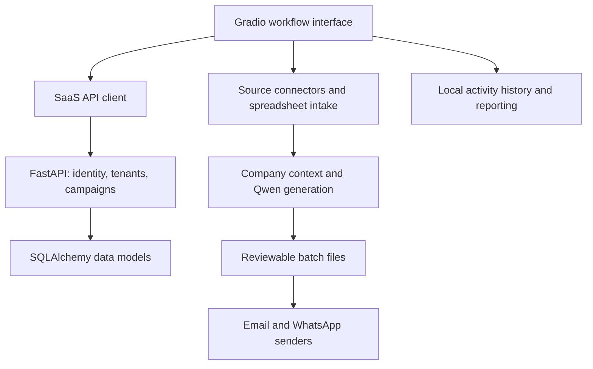

# Architecture and source evidence

Reviewed source: **[AI-leads-Saas-gradio at 22e66e2](https://github.com/mohamedabdelaty74/AI-leads-Saas-gradio/tree/22e66e25c2d89fc72fe989534a9c8aa11758eaf1)**. Links below preserve that snapshot.

## Component relationships

This maps responsibilities visible in source. It does not imply that every path is deployed
or that the public tree is a complete runnable release. The separately published web-dashboard
gallery is described in the [product walkthrough](product-walkthrough.md).

## Inspect the implementation

| Concern | Evidence | What it establishes |
|---|---|---|
| Multi-step application workflow | [Gradio collection/enrichment/content controls](https://github.com/mohamedabdelaty74/AI-leads-Saas-gradio/blob/22e66e25c2d89fc72fe989534a9c8aa11758eaf1/gradio_saas_integrated.py#L1591) | Operator-facing stages and integration code |
| Account and tenant context | [Backend dependencies](https://github.com/mohamedabdelaty74/AI-leads-Saas-gradio/blob/22e66e25c2d89fc72fe989534a9c8aa11758eaf1/backend/dependencies.py#L49) | Authenticated-user and tenant-resolution dependencies |
| Tenant-aware campaign access | [Campaign creation, listing, and lookup](https://github.com/mohamedabdelaty74/AI-leads-Saas-gradio/blob/22e66e25c2d89fc72fe989534a9c8aa11758eaf1/backend/main.py#L338) | Tenant-associated writes and tenant-scoped query conditions |
| Lead/API shape mapping | [Collection-to-campaign adapter and bulk upload](https://github.com/mohamedabdelaty74/AI-leads-Saas-gradio/blob/22e66e25c2d89fc72fe989534a9c8aa11758eaf1/saas_api_client_minimal.py#L79) | Mapping source parameters and collected rows into campaign APIs |
| Business discovery | [Google Maps connector](https://github.com/mohamedabdelaty74/AI-leads-Saas-gradio/blob/22e66e25c2d89fc72fe989534a9c8aa11758eaf1/scrapers/google_scrapers_fixed.py#L103), [LinkedIn connector](https://github.com/mohamedabdelaty74/AI-leads-Saas-gradio/blob/22e66e25c2d89fc72fe989534a9c8aa11758eaf1/scrapers/linkedin_scraper.py), [Instagram connector](https://github.com/mohamedabdelaty74/AI-leads-Saas-gradio/blob/22e66e25c2d89fc72fe989534a9c8aa11758eaf1/scrapers/instagram_scraper.py) | Collection paths for the three advertised sources; current external-service behavior still needs testing |
| Qwen integration | [Application model startup](https://github.com/mohamedabdelaty74/AI-leads-Saas-gradio/blob/22e66e25c2d89fc72fe989534a9c8aa11758eaf1/gradio_saas_integrated.py#L35), [shared registry](https://github.com/mohamedabdelaty74/AI-leads-Saas-gradio/blob/22e66e25c2d89fc72fe989534a9c8aa11758eaf1/gen/model_manager.py) | Configured model initialization and a model-sharing mechanism |
| Personalized batch content | [Email generator](https://github.com/mohamedabdelaty74/AI-leads-Saas-gradio/blob/22e66e25c2d89fc72fe989534a9c8aa11758eaf1/gen/generate_mail.py#L48), [WhatsApp generator](https://github.com/mohamedabdelaty74/AI-leads-Saas-gradio/blob/22e66e25c2d89fc72fe989534a9c8aa11758eaf1/gen/generate_whats.py#L57) | Company-context prompts and batch-generation code; generator model wiring requires a runtime check |
| Outbound channel integrations | [SMTP email sender](https://github.com/mohamedabdelaty74/AI-leads-Saas-gradio/blob/22e66e25c2d89fc72fe989534a9c8aa11758eaf1/senders/send_mail.py#L13), [WhatsApp sender](https://github.com/mohamedabdelaty74/AI-leads-Saas-gradio/blob/22e66e25c2d89fc72fe989534a9c8aa11758eaf1/senders/send_whats.py#L57) | Separate channel payloads, send operations, and response handling |
| Activity reporting | [History-based analytics](https://github.com/mohamedabdelaty74/AI-leads-Saas-gradio/blob/22e66e25c2d89fc72fe989534a9c8aa11758eaf1/gradio_saas_integrated.py#L999) | Reporting from recorded application actions, rather than proof of recipient delivery or sales |
| Container packaging | [Dockerfile](https://github.com/mohamedabdelaty74/AI-leads-Saas-gradio/blob/22e66e25c2d89fc72fe989534a9c8aa11758eaf1/Dockerfile) | CUDA/Python application packaging and a Gradio health check; no build result is claimed here |

## Boundaries to keep explicit

- A tenant filter in source is implementation evidence; complete tenant isolation needs route and concurrency tests.
- The public Gradio snapshot uses process-global login state. Per-session identity handling needs verification before using that interface with concurrent organizations.
- A generated message, a queued action, SMTP/API acceptance, delivery, an opened message, and a conversion are different outcomes.
- Local batch artifacts and API records need reconciliation after a failed upload or retry.
- A model registry exists, but generation modules initialize their own references to `None`; a complete runtime check must establish which paths receive the shared model.

These distinctions guide the [validation plan](validation.md) and the claims made in the case study.
